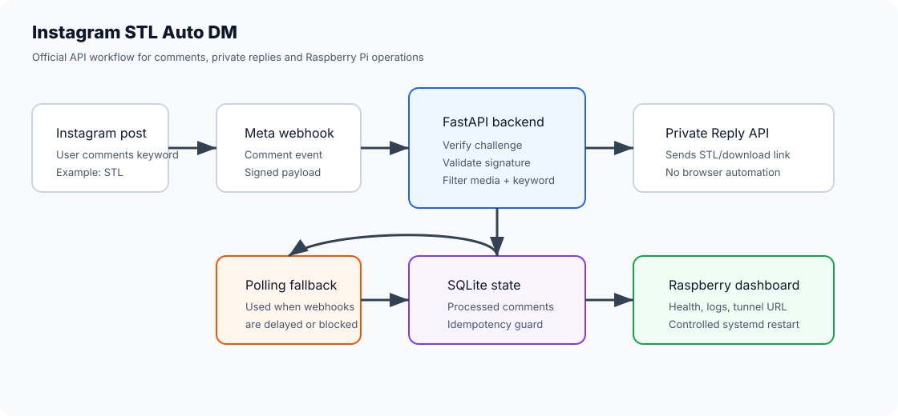
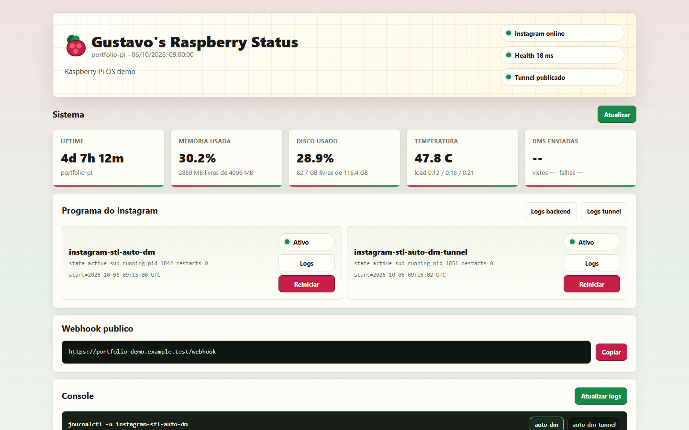

# Instagram STL Auto DM

[English / README principal](README.md) · Português (Brasil)

Automação do Instagram com a API oficial para enviar uma resposta privada quando alguém comenta uma palavra-chave configurada, como `STL`, em uma publicação selecionada.





## Destaques para o portfólio

- Integração com Meta Webhooks e Instagram Private Replies.
- Validação de assinatura `X-Hub-Signature-256`.
- Idempotência com SQLite para evitar respostas duplicadas.
- Consulta periódica como alternativa quando os webhooks não chegam em tempo real.
- Implantação no Raspberry Pi com `systemd`.
- Painel separado para monitoramento dos serviços.
- Testes com payloads fictícios, sem chamar a API real.

Veja também: [`docs/portfolio-case-study.md`](docs/portfolio-case-study.md).

Para reproduzir a captura de tela sem ler serviços locais, logs, nomes de hosts ou URLs de túneis:

```bash
MONITOR_DEMO_MODE=true uvicorn monitor.app:app --host 127.0.0.1 --port 8091
```

O modo de demonstração retorna um estado fixo e fictício do Raspberry e nunca chama `systemctl`, `journalctl`
ou o endpoint de integridade de produção.

O projeto usa Python, FastAPI, Meta Webhooks, SQLite e Instagram Private Replies. O objetivo é evitar automação de navegador, scraping e Selenium em um fluxo que precisa ser confiável em um Raspberry Pi.

Quando os webhooks da Meta não são entregues em tempo real devido à análise do aplicativo ou a limitações de acesso, o backend também pode consultar os comentários periodicamente como alternativa.

## Estado atual

MVP com:

- Endpoint `GET /webhook` para verificação da Meta.
- Endpoint `POST /webhook` para eventos de comentários.
- Validação de assinatura `X-Hub-Signature-256`.
- Filtragem por `media_id` e palavra-chave.
- Envio de Private Reply por um endpoint de mensagens configurável.
- Idempotência com SQLite para que o mesmo comentário não seja respondido duas vezes.
- Consulta periódica opcional de comentários como alternativa.
- Testes com payloads fictícios, sem chamar a API real da Meta.

## Estrutura

```text
app/
  main.py
  config.py
  database.py
  security.py
  routes/
    webhook.py
  services/
    automations.py
    instagram.py
data/
tests/
.env.example
requirements.txt
run.py
```

## Instalação

```bash
python -m venv .venv
.venv\Scripts\activate
pip install -r requirements.txt
```

No Linux/Raspberry Pi:

```bash
python3 -m venv .venv
source .venv/bin/activate
pip install -r requirements.txt
```

## Configuração

Crie um arquivo `.env` com base em `.env.example`.

```env
VERIFY_TOKEN=a_token_you_choose
META_APP_SECRET=your_meta_app_secret
IG_ACCESS_TOKEN=your_access_token
IG_USER_ID=your_instagram_user_id
TARGET_MEDIA_ID=target_post_id
STL_KEYWORD=STL
STL_LINK=https://example.com/download/model.stl
GRAPH_VERSION=v26.0
```

Para múltiplas automações, use `AUTOMATIONS_JSON`:

```env
AUTOMATIONS_JSON=[{"media_id":"180...","keyword":"STL","link":"https://example.com/model.stl"}]
```

Se os webhooks da Meta não estiverem chegando, habilite a consulta periódica de comentários:

```env
COMMENT_POLLING_ENABLED=true
COMMENT_POLLING_INTERVAL_SECONDS=30
COMMENT_POLLING_LIMIT=25
```

## Execução local

```bash
python run.py
```

Ou:

```bash
uvicorn app.main:app --host 0.0.0.0 --port 8000 --reload
```

URL local:

```text
http://localhost:8000
```

Para que a Meta chame o webhook durante o desenvolvimento, exponha a porta por uma URL HTTPS, por exemplo com ngrok ou Cloudflare Tunnel:

```text
https://your-domain-or-tunnel/webhook
```

## Execução no Raspberry Pi

O Raspberry Pi deve manter o backend em execução 24 horas por dia, 7 dias por semana. Use um serviço `systemd` para que ele inicie com o sistema e reinicie em caso de falha.

1. Clone ou copie este projeto para o Raspberry Pi:

```bash
sudo mkdir -p /opt/instagram-stl-auto-dm
sudo chown -R pi:pi /opt/instagram-stl-auto-dm
git clone <your-repository-url> /opt/instagram-stl-auto-dm
```

Mantenha `.env` fora do Git.

2. Execute o script de configuração:

```bash
cd /opt/instagram-stl-auto-dm
chmod +x deploy/raspberry-setup.sh
sudo ./deploy/raspberry-setup.sh
```

3. Edite `.env` no Raspberry Pi com os valores reais:

```bash
nano /opt/instagram-stl-auto-dm/.env
```

4. Inicie ou reinicie o serviço:

```bash
sudo systemctl restart instagram-stl-auto-dm
sudo systemctl status instagram-stl-auto-dm --no-pager
```

5. Teste localmente no Raspberry Pi:

```bash
curl http://127.0.0.1:8000/health
```

6. Crie uma URL HTTPS pública apontando para `127.0.0.1:8000` e use-a no painel da Meta:

```text
https://your-public-url/webhook
```

Para uso real, prefira uma URL estável. Cloudflare Tunnel com um domínio personalizado, domínios reservados do ngrok, Nginx com HTTPS ou uma VPS evitam mudar a URL de callback toda vez que o túnel reinicia.

Para testes rápidos sem um domínio personalizado, instale `cloudflared` e execute um túnel rápido apontando para o serviço local:

```bash
sudo systemctl status instagram-stl-auto-dm-tunnel --no-pager
journalctl -u instagram-stl-auto-dm-tunnel --no-pager -n 120 | grep -Eo 'https://[-a-zA-Z0-9.]+\.trycloudflare\.com' | tail -n 1
```

Use a URL retornada com `/webhook` no painel da Meta. Esse tipo de túnel é bom para testes, mas a URL pode mudar quando o serviço reinicia.

## Painel de status

O projeto também inclui um painel separado para monitorar o Raspberry Pi e os serviços de automação. Ele roda na porta `8080` e mostra:

- Estado de conexão do Raspberry Pi.
- Tempo de atividade, memória, disco e temperatura.
- Se `instagram-stl-auto-dm` está ativo.
- Se o túnel público está ativo.
- URL pública atual do webhook, quando encontrada nos logs.
- Logs do `systemd`.
- Botões para reiniciar os serviços de backend e túnel.

No Raspberry Pi:

```bash
sudo cp /opt/instagram-stl-auto-dm/deploy/raspberry-status.service /etc/systemd/system/raspberry-status.service
sudo systemctl daemon-reload
sudo systemctl enable raspberry-status
sudo systemctl restart raspberry-status
```

Abra na rede local:

```text
http://192.168.0.105:8080
```

JSON direto:

```text
http://192.168.0.105:8080/api/status
```

Logs:

```text
http://192.168.0.105:8080/api/logs/instagram-stl-auto-dm
http://192.168.0.105:8080/api/logs/instagram-stl-auto-dm-tunnel
```

Os botões de reinicialização do painel chamam:

```text
POST /api/services/instagram-stl-auto-dm/restart
POST /api/services/instagram-stl-auto-dm-tunnel/restart
```

Reiniciar `instagram-stl-auto-dm` mantém o túnel ativo. Reiniciar `instagram-stl-auto-dm-tunnel` pode gerar uma nova URL `trycloudflare.com`, que também deve ser atualizada no painel da Meta.

## Reinicialização automática

Para reduzir o risco de problemas em serviços executados por longos períodos, o projeto inclui um temporizador opcional que reinicia apenas o backend `instagram-stl-auto-dm` todos os dias antes do tráfego da manhã. Ele não reinicia o Raspberry Pi inteiro nem o túnel, então a URL pública permanece a mesma.

Instale e habilite no Raspberry Pi:

```bash
sudo cp /opt/instagram-stl-auto-dm/deploy/instagram-stl-auto-dm-restart.service /etc/systemd/system/
sudo cp /opt/instagram-stl-auto-dm/deploy/instagram-stl-auto-dm-restart.timer /etc/systemd/system/
sudo systemctl daemon-reload
sudo systemctl enable --now instagram-stl-auto-dm-restart.timer
systemctl list-timers instagram-stl-auto-dm-restart.timer
```

Por padrão, ele roda todos os dias às `04:10`, com até 10 minutos de atraso aleatório.

## Testes

```bash
pytest
```

## Fontes oficiais para acompanhar

Confirmado na documentação oficial da Meta em 2026-08-16:

- [Respostas privadas do Instagram](https://developers.facebook.com/documentation/instagram-platform/private-replies)
- [Respostas privadas nas mensagens do Instagram](https://developers.facebook.com/documentation/business-messaging/instagram-messaging/features/private-replies)
- [Webhooks da Graph API](https://developers.facebook.com/docs/graph-api/webhooks/getting-started/)
- [Webhooks do Instagram](https://developers.facebook.com/docs/graph-api/webhooks/getting-started/webhooks-for-instagram/)
- [Referência de permissões](https://developers.facebook.com/docs/permissions/)

Antes de usar em produção, revise o painel da Meta para confirmar quais permissões e recursos exigem App Review ou Advanced Access para a conta e o tipo de login escolhidos.

## Próximos passos

1. Crie e configure o aplicativo no Meta for Developers.
2. Conecte uma conta profissional do Instagram.
3. Obtenha `IG_USER_ID`, `IG_ACCESS_TOKEN`, `APP_SECRET` e `TARGET_MEDIA_ID`.
4. Implante o backend por trás de uma URL HTTPS pública.
5. Registre o webhook no painel da Meta e assine os eventos de comentários.
6. Teste o fluxo real comentando `STL` na publicação configurada.
